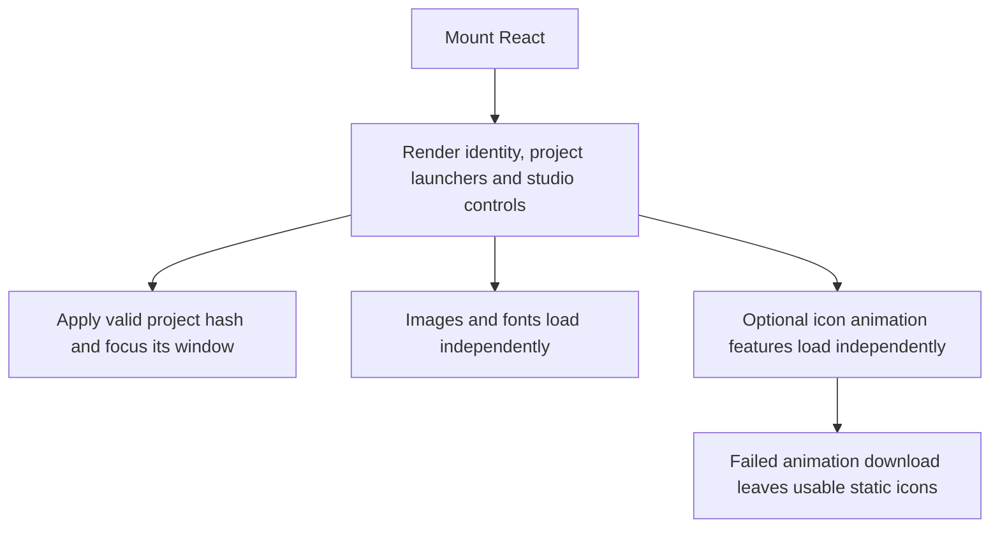
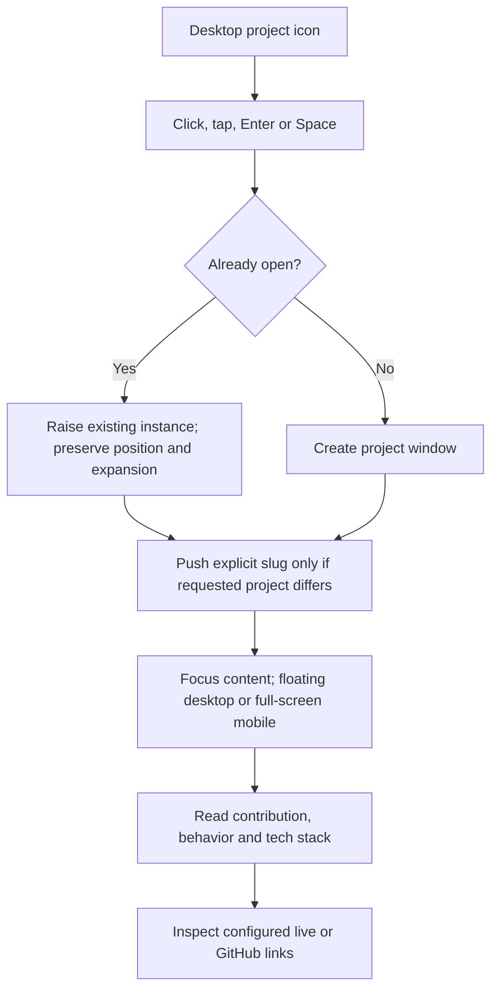
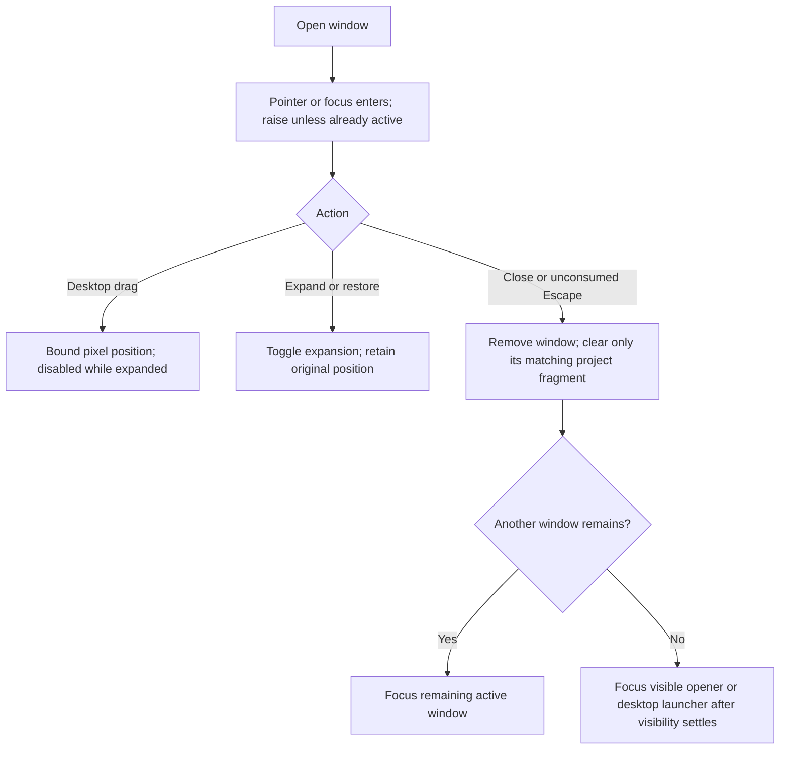
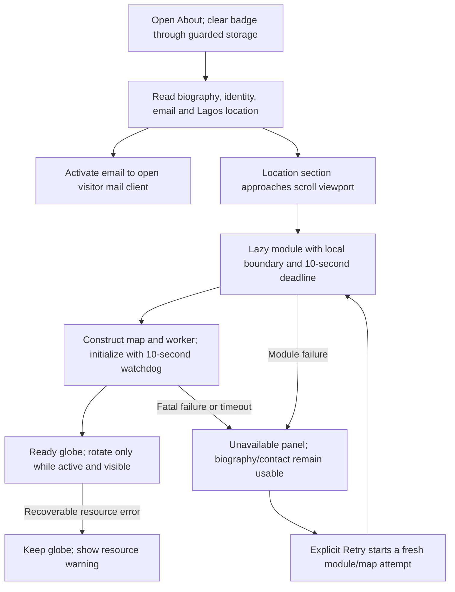
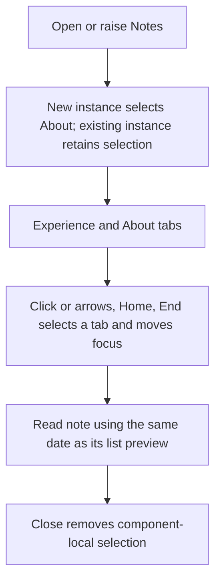
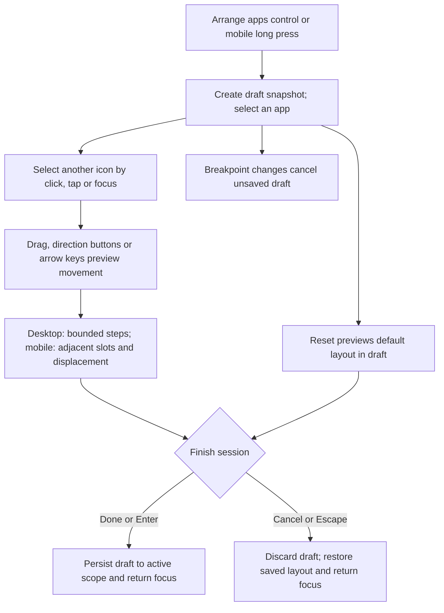
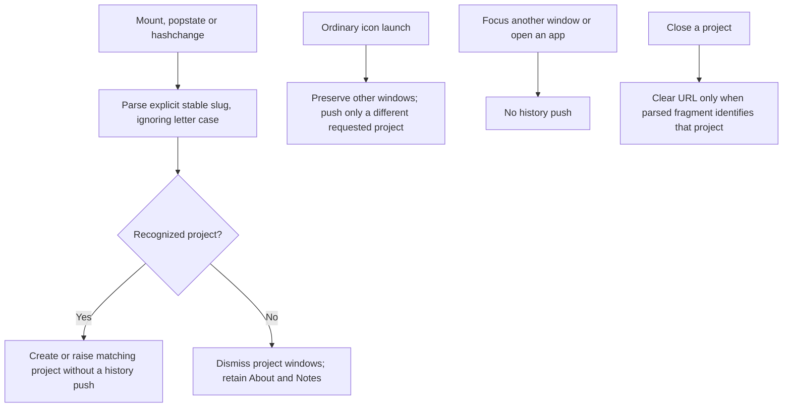

# Portfolio App Flows

## Current contract — 15 November 2026

Current backend flow: exact origin/host checks → lightweight readiness → trusted identity/IP → visitor/IP/global concurrency → atomic rolling quotas → bounded JSON/history → guarded retrieval/generation → NDJSON cleanup. Rejected quota/busy requests retain the draft and consume no admission allowance. Old dated UI diagrams are historical where later choices differ.

See [RAG security and release contract](RAG_SECURITY.md), [assistant integration](ASSISTANT.md), and [evaluation evidence](AI_EVALUATION.md). Historical screenshots, raw performance JSON and dated measurements are preserved; they are not new security or quality results.

## Current flow changes — 16 November 2026

Entry immediately presents the avatar introduction and project launchers without a blocking boot sequence. Start with BlockScan opens the same hash-backed project window as its app icon and restores focus on dismissal. Compact home views scroll; mobile windows remain full-screen and make the covered home inert. Desktop icon coordinates are relative to the app region; legacy arrangements migrate once to versioned keys with collision resolution and retain the original storage key.

Cases begin with contribution/status/decisions and live/source actions, followed by selected screenshots and optional implementation detail. Sound is a persistent opt-in preference. About shows useful location text before the explicit Explore globe action. Assistant suggestions fill a draft without sending, and retrieved-reference lists remain hidden while bounded metadata retains stream/history compatibility. The diagrams below are historical where they still show blocking boot or automatic geography.

Updated: 16 November 2026. The diagrams retain the remediated portfolio flows; the [assistant guide](ASSISTANT.md) adds local streaming chat, history choices, cancellation, and recovery. Stable flow IDs retain continuity with the original baseline. [Requirements](PRD.md), [data contracts](BACKEND_SCHEMA.md), and [verification](IMPLEMENTATION_PLAN.md#verification-scenarios) provide supporting detail.

## FLOW-01 — Entry and loading

REQ-10/11/13 · V-01/10/11/12.

Current entry is immediate. The preloader component, boot timers, session marker writes, orb dependency, and boot CSS have been removed. Landing controls and direct-link windows do not wait for portraits, fonts, or screenshot downloads. Existing image fallbacks remain in place.

[App](../src/App.tsx) enables the window manager immediately. Contact retains its envelope and label; hovering or focusing opens the flap briefly, with static artwork under reduced motion. No entrance overlay or artificial delay blocks navigation.

## FLOW-02 — Explore a project

REQ-02/03/05 · V-02/07/12.

[DesktopIcon](../src/components/desktop/DesktopIcon.tsx), [window manager](../src/hooks/useWindowManager.ts), and [ProjectWindow](../src/components/windows/ProjectWindow.tsx). Project hover previews are removed; hover/focus does not launch a preview. One image renders; missing supplied image requests produce “Preview unavailable.” Escrow remains repository-only; Policy.ng remains live-link-only. External links open separately.

## FLOW-03 — Window lifecycle and focus

REQ-04/05/09 · V-03/04/07.

[Reducer](../src/state/windows.ts) and [WindowFrame](../src/components/windows/WindowFrame.tsx). Desktop dialogs are nonmodal; mobile backgrounds and covered windows are inert. Mobile hides expand/minimize and disables drag. Yellow minimize remains decorative. Escape first cancels an arrangement session. Close-button exit waits 180ms (zero for reduced motion); Escape dismisses immediately.

## FLOW-04 — About, contact, and optional geography

REQ-08/12 · V-09/13.

[About](../src/components/windows/AboutWindow.tsx), [GlobeSection](../src/components/map/GlobeSection.tsx), and [globe](../src/components/map/LocationGlobe.tsx). Static location does not depend on the enhancement. Connections are illustrative, not visitor/employer records. Cleanup releases resources on failure/close/retry. Dock GitHub/X/LinkedIn actions continue to open their configured profiles; there is no portfolio contact backend.

## FLOW-05 — Read Notes

REQ-08/09 · V-04/09/15.

[NotesWindow](../src/components/windows/NotesWindow.tsx), [notes data](../src/data/notes.ts), and [shared profile](../src/data/profile.ts). Desktop uses sidebar/reader; mobile places tabs above the reader. Notes remains read-only, with no note database or editing flow.

## FLOW-06 — Rearrange, reset, commit, or cancel

REQ-06/09/11 · V-06/08/11.

[App commands](../src/App.tsx), [layout hook](../src/hooks/useDesktopLayout.ts), and [layout operations](../src/state/layout.ts). Current arrangement uses adjacent responsive slots on desktop/mobile; legacy 10px coordinate moves are superseded. Mobile drops snap and swap within the draft. Boundary moves clamp. A polite status announces selection/movement. Ordinary desktop dragging outside arrangement mode swaps slots and persists their order. Reset outside arrangement mode affects only that scope; denied storage never prevents in-memory operation.

## FLOW-07 — Project links and browser history

REQ-07 · V-05.

[Manager](../src/hooks/useWindowManager.ts), [reducer](../src/state/windows.ts), and [slug mapping](BACKEND_SCHEMA.md#identifiers-and-url-mapping). Duplicate native events are idempotent. The fragment selects a project but does not store the whole workspace; richer workspace history is not introduced.

**Implemented locally:** Assistant dock entry, grounded streaming chat, optional browser history, Stop/Clear and failure recovery are specified in the [assistant guide](ASSISTANT.md). Retrieved references are hidden in the UI; three suggested questions fill the composer without sending. Public backend deployment remains deferred.

## FLOW-08 — Current visitor chat and denial lifecycle

1. Prepare the lazy Assistant module without a provider call; typing or selecting a suggestion changes only the draft.
2. Send bounded question/history with credentials to the exact API origin.
3. Validate origin/host and read-only readiness; resolve signed visitor cookie and trusted proxy IP.
4. Reject a busy visitor/IP/global slot before admission; otherwise hold capacity through ASGI cleanup.
5. Atomically check visitor 3/minute, IP 6/minute and 20/24h, then global 30/minute.
6. Bound body, validate/trim history, retrieve curated evidence, reserve costs before provider calls and stream bounded text.
7. Render only approved clickable destinations. On Stop, failure, disconnect or completion, release all slots; retain drafts on rejection without automatic retries.

429 responses distinguish visitor/network/global limits; optional retrieved-reference metadata remains separate from model history and is not visibly listed. No public ingestion, account API, Chroma administration or model execution tools are introduced.
