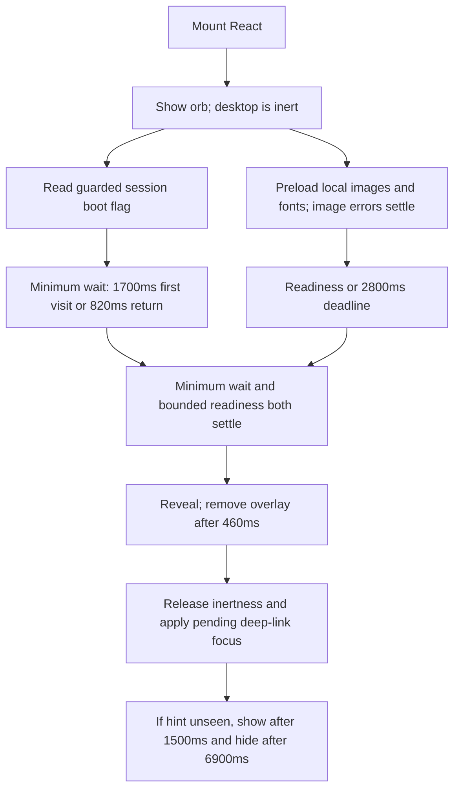
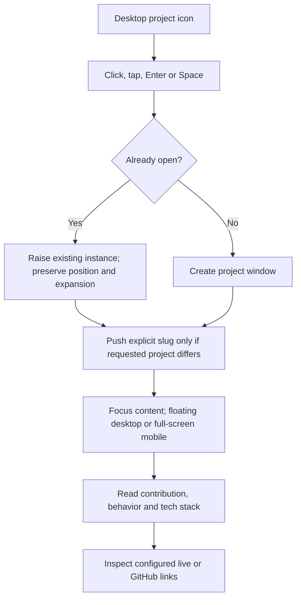
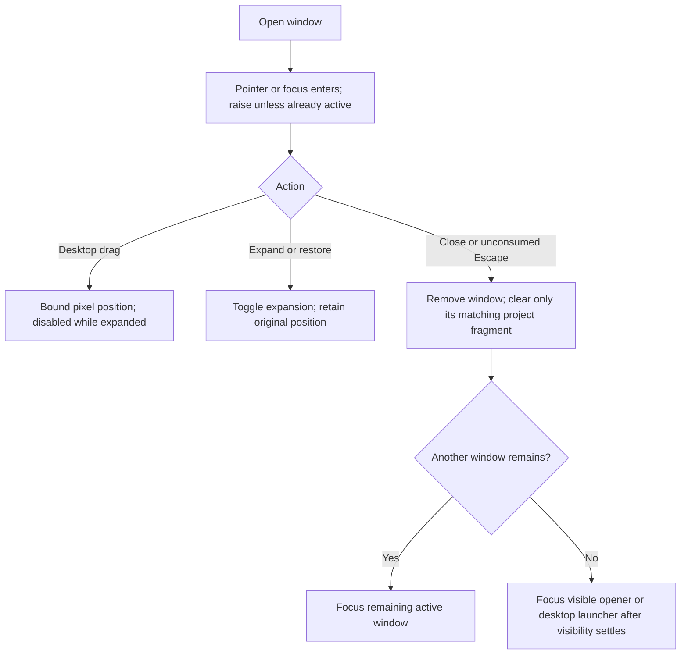
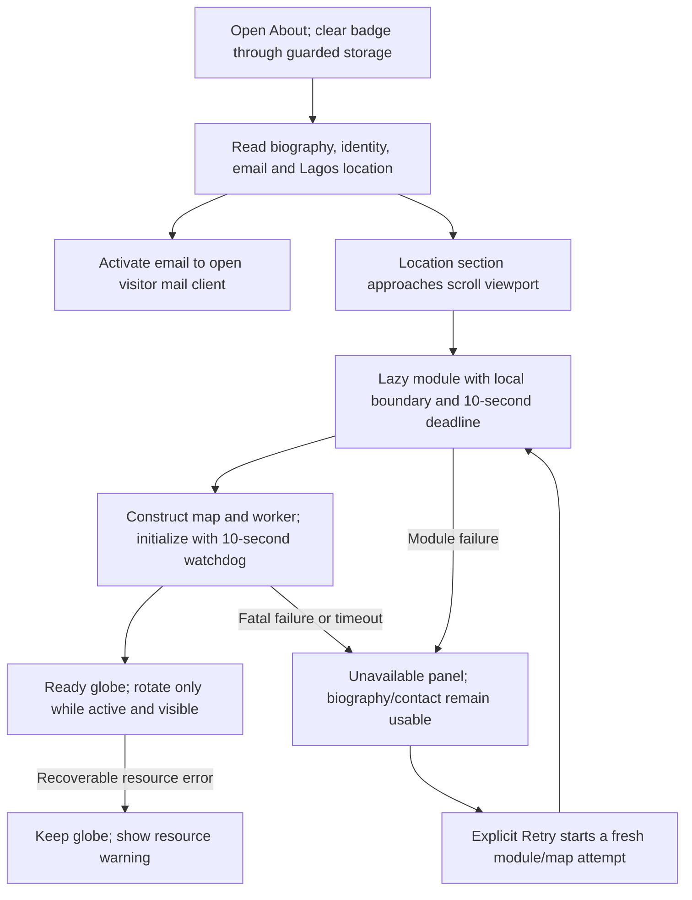
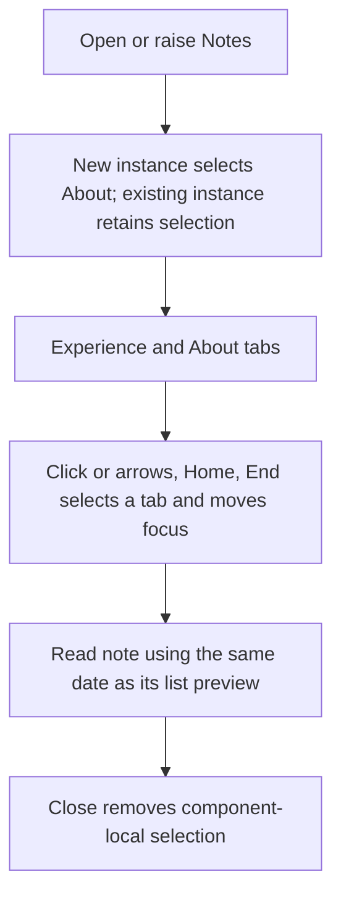
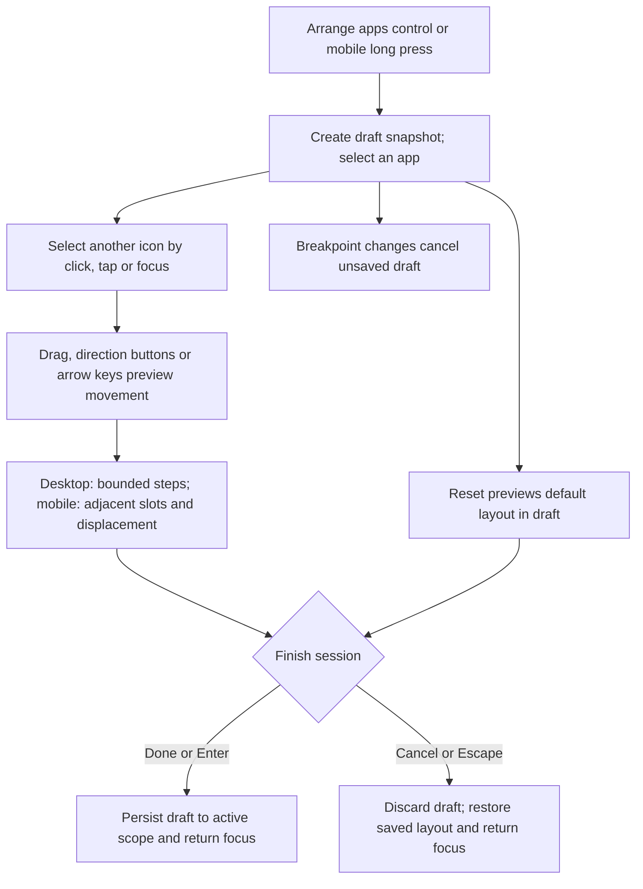
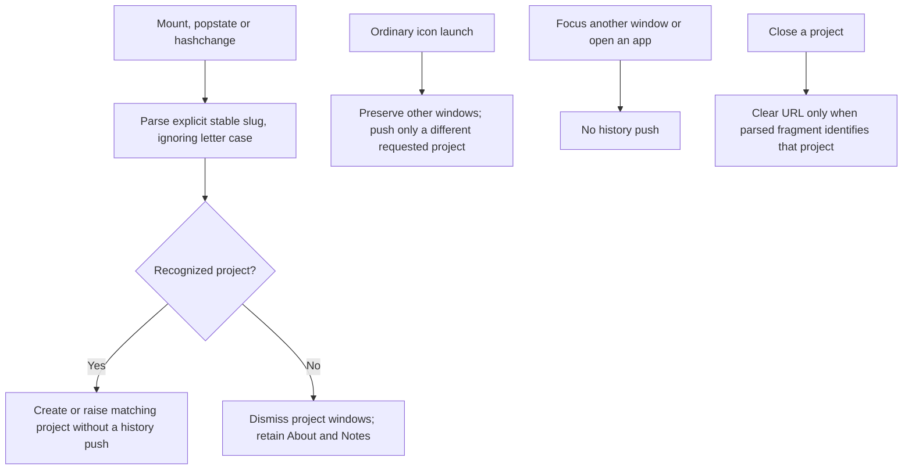

# Portfolio App Flows

Updated: 10 November 2026 · **Implemented** remediated pre-RAG behavior. Stable flow IDs retain continuity with the original baseline. [Requirements](PRD.md), [data contracts](BACKEND_SCHEMA.md), and [verification](IMPLEMENTATION_PLAN.md#verification-scenarios) provide supporting detail.

## FLOW-01 — Entry and loading

REQ-10/11/13 · V-01/10/11/12.

[Preloader](../src/components/effects/BootPreloader.tsx), [App](../src/App.tsx), and [session helper](../src/utils/storage.ts). Hint reads/delayed writes are guarded. Reduced motion makes the orb static and shortens supported effects, while configured boot minimums remain. The waits are not measured latency claims.

## FLOW-02 — Explore a project

REQ-02/03/05 · V-02/07/12.

[DesktopIcon](../src/components/desktop/DesktopIcon.tsx), [window manager](../src/hooks/useWindowManager.ts), and [ProjectWindow](../src/components/windows/ProjectWindow.tsx). Desktop hover/focus previews appear only without an open window or arrangement session. One image renders; missing supplied image requests produce “Preview unavailable.” Escrow remains repository-only; Policy.ng remains live-link-only. External links open separately.

## FLOW-03 — Window lifecycle and focus

REQ-04/05/09 · V-03/04/07.

[Reducer](../src/state/windows.ts) and [WindowFrame](../src/components/windows/WindowFrame.tsx). Desktop dialogs are nonmodal; mobile backgrounds and covered windows are inert. Mobile hides expand/minimize and disables drag. Yellow minimize remains decorative. Escape first cancels an arrangement session. Close-button exit waits 180ms (zero for reduced motion); Escape dismisses immediately.

## FLOW-04 — About, contact, and optional geography

REQ-08/12 · V-09/13.

[About](../src/components/windows/AboutWindow.tsx), [GlobeSection](../src/components/map/GlobeSection.tsx), and [globe](../src/components/map/LocationGlobe.tsx). Static location does not depend on the enhancement. Connections are illustrative, not visitor/employer records. Cleanup releases resources on failure/close/retry. Dock GitHub/X/LinkedIn actions continue to open their configured profiles; there is no portfolio contact backend.

## FLOW-05 — Read Notes

REQ-08/09 · V-04/09/15.

[NotesWindow](../src/components/windows/NotesWindow.tsx), [notes data](../src/data/notes.ts), and [shared profile](../src/data/profile.ts). Desktop uses sidebar/reader; mobile places tabs above the reader. Notes remains read-only, with no note database or editing flow.

## FLOW-06 — Rearrange, reset, commit, or cancel

REQ-06/09/11 · V-06/08/11.

[App commands](../src/App.tsx), [layout hook](../src/hooks/useDesktopLayout.ts), and [layout operations](../src/state/layout.ts). Desktop arrows move 10px, mobile arrows/buttons move adjacent slots without wrapping. Mobile drops snap and swap within the draft. Boundary moves clamp. A polite status announces selection/movement. Ordinary desktop dragging outside arrangement mode still persists directly. Reset outside arrangement mode affects only that scope; denied storage never prevents in-memory operation.

## FLOW-07 — Project links and browser history

REQ-07 · V-05.

[Manager](../src/hooks/useWindowManager.ts), [reducer](../src/state/windows.ts), and [slug mapping](BACKEND_SCHEMA.md#identifiers-and-url-mapping). Duplicate native events are idempotent. The fragment selects a project but does not store the whole workspace; richer workspace history is not introduced.

**Deferred:** conversational entry, retrieval, streaming, citations, chat persistence, and assistant failures require the later RAG specification.
