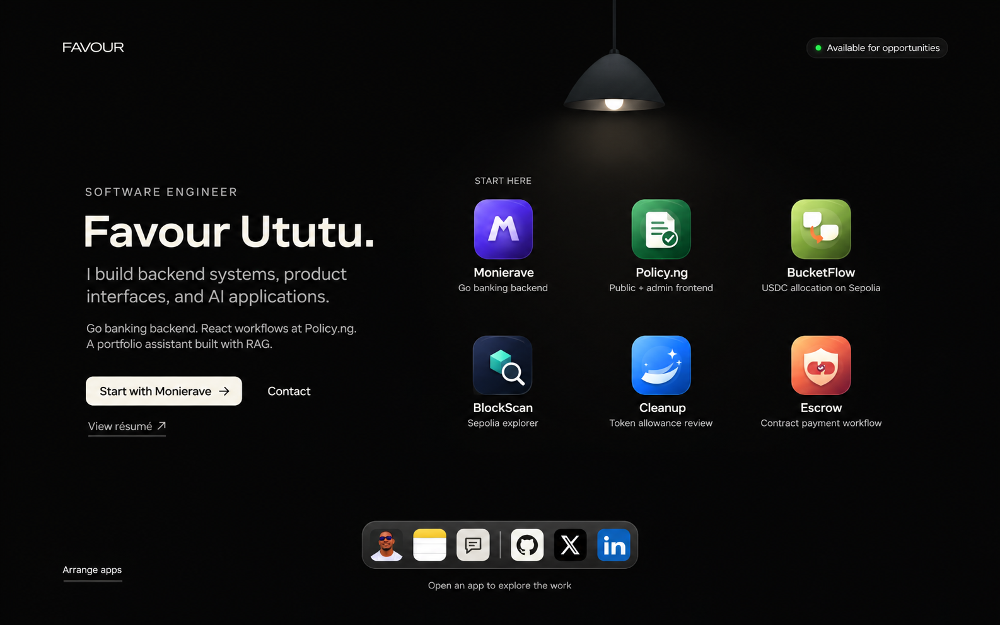

# Portfolio Value and Engineering Evidence Implementation Plan

## Current contract — 15 November 2026

This is the original product/evidence specification, not the current visual blueprint. Later owner choices removed the lamp, project subtitles, hover previews, separate name heading, Back to desktop and Ask AI case controls, and restored original case windows with Previous/Next. Current backend hardening and remaining evidence work are specified in RAG_SECURITY.md; no reranker or paid evaluation was added.

See [RAG security and release contract](RAG_SECURITY.md), [assistant integration](ASSISTANT.md), and [evaluation evidence](AI_EVALUATION.md). Historical screenshots, raw performance JSON and dated measurements are preserved; they are not new security or quality results.

Status: implementation specification with local delivery recorded on 12 November 2026. The selected desktop composition, prominent introduction and existing avatar are implemented locally. The [delivery record](PORTFOLIO_DELIVERY.md) distinguishes completed application work from outstanding live evaluation, hosted rollout and external-project evidence. The detailed batches below remain the acceptance specification.

The outcome is a portfolio that explains Favour's role and strongest work immediately, then makes personal contribution, technical decisions and supporting evidence easy to inspect. The dark working desktop remains the visual and interaction foundation.

## Original selected direction — superseded where noted above

Use this image for composition and emphasis, with the avatar addition specified below. Product copy and current source remain authoritative for factual claims; generated imagery is not engineering evidence.

- Keep FAVOUR branding, pendant lamp, six tactile project icons, translucent dock, draggable arrangement, project windows and deep links.
- Put the introduction directly on the left side of the wallpaper. Keep the accepted name prominence. Add the existing portrait beside the role/name grouping, approximately 72–80px on a roomy desktop and 56–64px in compact layouts, with reserved image dimensions.
- Keep Monierave as the initial recommended case. Policy.ng and the assistant provide the clearest complementary frontend and AI evidence. All six existing projects remain available.
- Use one primary action, Start with Monierave, followed by Contact and a resume link when its real asset exists. The primary action opens the existing project window; it does not introduce a tour, a new navigation framework or a second project route.
- Show short, persistent project descriptions so project meaning does not depend on hover. Use the accepted top-row emphasis of Monierave, Policy.ng and BucketFlow.

## Content and interaction contract

Proposed introduction, grounded in the existing profile:

> SOFTWARE ENGINEER 
> Favour Ututu. 
> I build backend systems, product interfaces, and AI applications. 
> Go banking backend. React workflows at Policy.ng. A portfolio assistant built with RAG.

The short supporting line describes project scope; it must not imply that all projects have equal production maturity. Detailed ownership, deployment status and limitations remain visible in the cases.

Use the shared profile for name, positioning, portrait and contact. Add a small typed presentation configuration for featured project and optional resume destination. Reuse PortraitAvatar and the existing window manager. Do not put an unimplemented resume button in the interface: omit it until the actual file or verified destination is supplied.

The introduction remains visible in the idle desktop state. On desktop, opening a window subdues it alongside the existing background treatment while the active window gets visual priority. Uncovered desktop controls retain the existing nonmodal interaction contract. On mobile, covered desktop content, including the introduction, is inert while a full-screen window is open. Arrangement mode reduces the introduction's prominence and gives the arrangement toolbar clear priority. Escape, Back/Forward, repeated launches and focus restoration use the existing manager.

## Delivery sequence

| Batch | Deliverable | Dependency | Completion condition |
|---|---|---|---|
| 1 | Avatar introduction, recommended case, readable app descriptions, responsive geometry | Accepted direction and existing assets | Identity, scope, starting point and contact are visible; original desktop flows still work |
| 2 | Immediate usable entry, compressed decoration, readable windows and preference controls | Batch 1 geometry | No artificial entry hold; reading and optional-resource failures are usable |
| 3 | Evidence-first project windows and selected screenshot galleries | Batch 1 and truthful project material | Each case exposes ownership, status, decisions and source/demo actions immediately |
| 4 | Useful assistant entry and inspectable retrieved evidence | Shared public project identities and Batch 3 case structure | Suggested questions and safe evidence references work across streaming, errors and restored history |
| 5 | Reproducible AI evaluation reports and measured baseline | Batch 4 transport changes and evaluation fixtures | Offline report pipeline works; separately run live reports distinguish measured results from implementation tests |
| 6 | Hosted reliability evidence and release record | Relevant application checks; hosting access for rollout | Actual deployment controls, cancellation, persistence and recovery are verified on the target host |
| Extension | Executable backend and deeper team-project evidence | Access to the corresponding project repositories and artifacts | Demonstrations run against the real system or are clearly labelled simulations |

Batches 1–3 form the first portfolio improvement release. Batches 4–6 form the subsequent AI evidence and operations release. The external backend extension is independent and must not delay the first-screen improvements.

## Batch 1 First screen and avatar

### Implementation

- Add a focused DesktopIntro component and small associated stylesheet, rather than expanding App.tsx with all presentation markup.
- Reuse PortraitAvatar with its higher-resolution existing WebP for the introduction. Preserve aspect ratio, dimensions and failure behavior. Avoid duplicate screen-reader announcements of an adjacent name.
- Give the visible name the page's primary heading role. Keep heading order coherent when windows open; do not leave the only meaningful heading hidden.
- Wire the featured-case action through openProject with its actual opener element, preserving focus return and the existing project hash.
- Reuse the existing public email for Contact. Keep availability copy consistent with the currently approved profile; do not add new commitments.
- Add short descriptions to desktop launchers with clear names and sufficient contrast. Remove the redundant central hover summary if it competes with the introduction; retain hover/focus feedback on the icons.
- Place introduction and apps in separate measured regions on roomy desktops. Preserve the relationship between lamp placement and icon lighting instead of treating the lamp as a fixed screenshot decoration.
- Use content-driven compact layouts on narrower or shorter screens. Stack introduction above the apps and allow the home surface to scroll where necessary. Keep full-screen project/assistant reading behavior, safe areas and dock clearance. Do not shrink text to force a large desktop composition into a small viewport.
- Update drag bounds and keyboard arrangement calculations to respect the project region. Preserve save/cancel, swapping, reset and non-drag alternatives.
- Version the changed desktop coordinate model and migrate valid legacy layouts into the new region while retaining relative arrangement where possible. Retain the old key for rollback, validate/clamp migrated points and avoid saving migrations repeatedly on resize. Do not silently delete the visitor's arrangement. Revalidate mobile slot geometry separately.

### Main touchpoints

src/App.tsx; new src/components/desktop/DesktopIntro.tsx; src/data/profile.ts; src/data/projects.ts; src/components/shared/PortraitAvatar.tsx; src/components/desktop/DesktopIcon.tsx; src/state/layout.ts; src/hooks/useDesktopLayout.ts; src/data/mobileLayout.ts; relevant desktop, lamp and responsive CSS.

### Acceptance

- Name, portrait, role, concise scope, recommended case and Contact are discoverable without hover or opening another window.
- All six apps, dock and arrangement controls remain available. The avatar adds identity without reducing the accepted name prominence.
- Primary-action launch, close/focus return, existing direct hashes, Back/Forward and duplicate launch behavior are intact.
- No collisions, clipped controls or lost app access across 1440×900, 1280×720, 1024×768, the existing 767/768 breakpoint and 390×844 / 375×667 phone layouts.
- Keyboard arrangement, persisted legacy layouts, denied storage and compact-to-desktop transitions remain usable.

## Batch 2 Entry performance and everyday usability

### Implementation

- Remove the fixed first/return visit boot minimums. Make identity and navigation usable independently of decorative image and font readiness. Keep only a short nonblocking entrance effect where useful.
- Load project screenshots on case opening. Stop requesting every featured screenshot during initial entry. Keep lamp art responsive and compressed; use the existing originals as sources and retain their visual character/transparency.
- Keep assistant and map code deferred until requested. A failed optional resource must not block the desktop or project links.
- Raise long case-study body text toward 15–16px with a comfortable measure. Reduce nested workspace padding where it constrains useful reading area.
- Show useful location text immediately. Load an interactive globe only on an explicit Explore globe action, with a bounded wait, fallback and Retry. Preserve map cleanup and reduced-motion behavior.
- Introduce a single interface-sound preference and shared playback helper. Route library-bound sounds and direct play calls through it: icon launch, lamp and Escape must all respect mute. Default sound off for a new visitor; persist explicit choice with guarded storage.
- Remove the decorative yellow minimize light for this release. Keep close and expand functional and named. Real minimization can be a separate feature if it later serves a clear need.
- Standardize visible project names, including BlockScan and Policy.ng, while preserving stable internal keys and current URL hashes.

### Acceptance

- No application-enforced waiting period blocks an otherwise usable first screen.
- Initial requests exclude unopened project screenshots, assistant modules and geography; compare actual request logs with the recorded baseline.
- Intro and navigation work when fonts, decorative images, avatar or geography fail.
- Muting suppresses both bound and directly triggered sounds and survives reload when storage is available.
- Contrast, focus visibility, keyboard traversal, reduced motion and 200% zoom receive actual checks; do not infer accessibility conformance from font size or source inspection.
- Run controlled cold-context performance comparisons with the same viewport, build and throttling conditions. Record transferred bytes and time to usable content. Report field Core Web Vitals only if field measurements actually exist.

## Batch 3 Project cases that expose evidence

### Implementation

- Establish a typed case summary: problem, personal role, project status, ownership boundaries, difficult decision, evidence and links. Reuse existing data where accurate; do not dump every legacy field into the page.
- Put title, one-sentence problem, contribution/status and source/demo actions in the opening region. Follow with a small number of decisions and evidence, then optional deeper explanations.
- Preserve the distinction between collaborative work, learning projects, testnet demonstrations and production usage. Never relabel a testnet product as production or invent business impact.
- Add a compact, keyboard-accessible screenshot selector using real supplied images and captions. Lazy-load unselected full-size images. If enlargement uses an overlay, implement Escape, focus containment and focus return.
- Keep repository-only Escrow distinct and honest. Replace awkward defensive product copy such as No fabricated product screenshot with clear wording such as Repository project, with an inspectable lifecycle artifact where available.
- Provide a direct case permalink through the existing hash model. Keep full product links and source links visible without scrolling through long stories.
- Make Monierave and Policy.ng the first complete cases, then apply the same structure to the other four.

### Evidence content

- Monierave: transfer invariants, idempotency/concurrency boundaries, outbox failure behavior and exact test/source links when inspected.
- Policy.ng: a public/admin workflow, specific personal responsibilities, data fetching/form/error decisions and shareable artifacts that respect team ownership.
- BucketFlow/Cleanup: permission/state rules, transaction feedback, actual test artifacts and documented testnet/coverage limitations.
- BlockScan: search classification, asynchronous states and data presentation, with its learning-project context retained.
- Escrow: roles and permitted lifecycle transitions; no deployed frontend claim.

### Acceptance

Each case makes problem, personal contribution, status and verification route legible in its first screen. Deep text remains available, gallery controls are accessible, unavailable assets have useful fallbacks, and every new factual claim has supporting evidence.

## Batch 4 Assistant usefulness and retrieved evidence

### Implementation

- Add up to three useful suggested questions to the empty state: contribution to Policy.ng, duplicate transfers in Monierave, and assistant limitations. Treat factual answer expectations as evidence-dependent.
- Keep Stop, Clear, opt-in browser history, draft recovery, timestamps, bounded inputs and mobile keyboard handling.
- Add a server-owned public source registry mapping curated document/project identities to readable titles and permitted public case/repository destinations. Do not accept source URLs, filesystem paths or executable links from the model.
- Extend the NDJSON contract to carry bounded retrieved-reference metadata alongside the existing delta/done/error events. Define ordering, cardinality, error and cancellation behavior, and rollout compatibility before changing the parser. A stream without new metadata must still display an answer.
- Show an expandable Retrieved references area attached to the particular answer. Use only the selected documents passed to generation, not a second search. Keep titles, section labels and short relevant excerpts public-safe and bounded.
- Label references accurately: a retrieved passage is not automatically proof of every claim in an answer. Treat claim-level citations as a later addition unless their reference validation and factual support can be evaluated properly.
- Extend stored message validation to optional bounded source metadata, retain legacy history compatibility and keep display metadata out of model history. Treat restored client data as untrusted; validate identities against the current public registry and do not imply historical references were freshly checked.
- Update the shared answer-result interface so the streaming API and evaluation path consume the same selected evidence. Avoid breaking the existing complete-answer and Gradio interfaces without explicit adapters/tests.

### Main touchpoints

src/components/assistant/AssistantFeature.tsx, stream.ts, history.ts and assistant.css; rag/api.py; rag/implementation/answer.py and guardrails.py; an explicit public source registry; assistant and API documentation.

### Acceptance

Evidence stays attached to the correct message through streaming, failure, Stop, Clear, history restoration and follow-ups. Malformed metadata, unknown IDs and unsafe links do not become active sources. No secrets, raw filesystem paths or corpus-dump endpoint are introduced. Existing budgets and cancellation behavior remain effective.

## Batch 5 AI quality and reproducible reports

### Implementation

- Preserve the existing 50-case benchmark and stable IDs as a baseline. Add a separately identified held-out set rather than quietly rewriting cases to improve the score.
- Run conversational and adversarial fixtures as their own suites. Cover missing facts, false premises, multi-turn references, ownership, current-versus-historical status, instruction injection and unsafe rendering.
- Add an owner-only runner that persists JSON results and a concise human-readable report. Record source revision, corpus fingerprint, prompt hash, model identifier, retrieval configuration, case IDs and run time.
- Retain MRR and section-based evidence coverage with their current limitations. Add human-reviewed factual support/unsupported-claim analysis, appropriate uncertainty and public-reference correctness. Keep evaluator-model opinions separate from human decisions.
- Capture retrieval, time-to-first-text and completion durations per run. Report sample counts with distributions; do not manufacture p95 reliability from a tiny sample.
- Capture actual provider usage where available. Label price-based calculations as estimates and keep them separate from conservative protection-ledger reservations, which are not actual bills.
- Establish baseline results before changing retrieval size, chunking, embeddings, prompts or model. Change one meaningful variable per comparison and retain failures as part of the case study.
- Add a reviewed, static summary artifact for the portfolio; keep live evaluation runners and raw diagnostics owner-only. Do not run paid model evaluations on every ordinary pull request.

### Acceptance

Offline fixtures demonstrate deterministic report/scoring behavior without network access. A separately initiated live run reports actual outputs, failure examples and manually reviewed disagreements. Only after that run may the portfolio publish quality/latency claims. Public reports omit private prompts/transcripts and internal paths.

## Batch 6 Deployment and operational evidence

Use the existing Pxxl deployment package as the starting architecture: the static frontend plus a bounded single-host Python service and persistent storage. Reconcile superseded documentation and verify current host/model capabilities before rollout; do not assume earlier documentation is proof of the current deployment.

- Check target-host edge throttling, global admission, spending limits, TLS/CORS, proxy buffering, request deadlines and disconnect propagation.
- Verify index and budget-ledger persistence across restart and redeploy. Test readiness on missing/stale state and cancellation followed by a healthy request.
- Keep request IDs, stage durations, error classes and usage summaries without logging prompts, retrieved text or raw provider exception bodies.
- Exercise maintenance mode, image rollback and index compatibility. Preserve the current budget ledger during rollback; do not restore an older ledger to replenish allowances.
- Record actual hosted smoke results, failure behavior and operational limitations. A local mocked stream is not evidence of hosted model latency.
- Fix or isolate reproducible event-loop resource warnings in development test lifecycles, without claiming that dependency warnings demonstrate a production leak.
- Update PRODUCT.md, DESIGN.md, README, APP_FLOW, ASSISTANT and relevant security/deployment contracts in the same release as the behavior they describe. Preserve historical validation records with dates.

Acceptance requires a real rollout record for the target host. Missing hosting access, paid-run authorization or resume material affects only the corresponding step; it does not block independent local work.

## External engineering evidence extension

This repository contains descriptions of other projects, not their complete implementations. Inspect the actual linked repository and permitted artifacts before promising executable demonstrations or claiming its correctness.

For Monierave, build a resettable synthetic-data demonstration against the real backend showing duplicate transfer replay, concurrent insufficient-funds competition and email-worker failure after commit. Inspect balances, balanced postings, transfer outcomes and eventual job recovery. Link exact integration tests. Any public sandbox must be isolated from real credentials, accounts and valuable funds, with bounded reset/abuse behavior. If a reliable hosted sandbox is not justified, an executable local integration harness with a recorded run is valid evidence; label simulations explicitly.

For Policy.ng, select one shareable public/admin workflow, explain ownership and document a difficult integration or failure-state decision. Use real artifacts the owner may publish. For AI, publish the measured failure-and-improvement case from Batch 5.

## Verification and release gates

Test observable behavior and meaningful boundaries, rather than duplicating implementation details or adding a test for every decorative change.

| Area | Required checks |
|---|---|
| Homepage | Default composition, avatar/image failure, primary launch/focus return, compact overflow, direct hashes |
| Layout persistence | Legacy migration, clamping, keyboard movement, save/cancel, storage denial, resize/scope transitions |
| Case studies | Ownership/status/link parity, screenshot switching, enlargement dismissal/focus, repository-only and missing-image states |
| Preferences | Bound and direct sounds respect mute; reduced motion and storage fallback |
| Assistant | NDJSON chunk boundaries and optional references, malformed input, unsafe URLs, cancellation/error recovery, old/new history |
| Python/API | Selected-evidence serialization, bounds, readiness, concurrency cleanup, budget failure, no raw-error disclosure |
| AI measurement | Baseline/held-out separation, report reproducibility, human review, measured-versus-estimated usage |
| Host | Persistent state, edge rules, stream delivery/cancellation, maintenance and rollback |

Run applicable lint, TypeScript, unit, Python and production-build checks per batch. Run the affected browser scenarios and complete existing cross-browser regression checks at release boundaries. Reuse the documented desktop Chromium, mobile Chromium and WebKit coverage. Record an unavailable browser/manual check as outstanding rather than as a pass.

For visual QA, inspect the shipped device classes in one batched desktop/compact/mobile pass, fix the discovered issues together and use at most one confirmation pass. Include 200% zoom, reduced motion, an open window, keyboard focus, missing assets and a saved old arrangement. Update the selected mockup with the requested avatar before treating it as the final visual comparison reference.

For a small comprehension check, ask representative reviewers to identify role, strongest case and contact route after five seconds, then explain contribution and evidence after twenty seconds. Record observations as usability findings, not statistical conversion claims.

## Dependencies and first implementation batch

- Avatar: existing 96px and 384px WebP assets are available and reusable.
- Resume: no verified asset/destination was found in the reviewed frontend. Omit the link until supplied; keep Contact and the featured case fully usable.
- External proof: access to Monierave/other project source and publishable artifacts is needed only for the extension.
- Live evaluation and public rollout: make their cost, inputs and concrete release artifact reviewable before separately initiating them. This planning task does not execute them.
- Working tree: preserve existing user changes. Keep implementation batches reviewable and do not commit or deploy as a side effect of planning.

The first implementation batch is the avatar introduction, app-region layout, persistent descriptions, featured-case action, responsive behavior, saved-layout compatibility and a usable immediate entrance. Finish that coherent vertical slice before expanding the AI or external backend scope.
